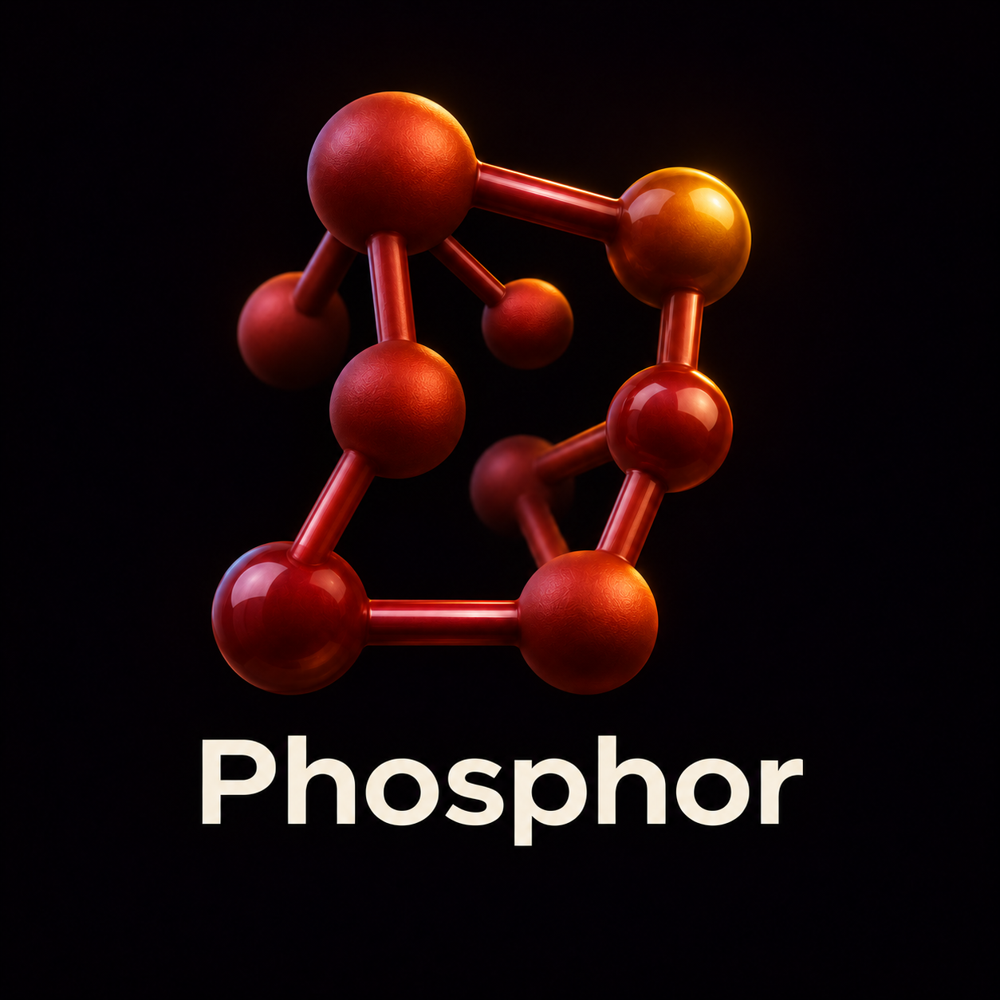
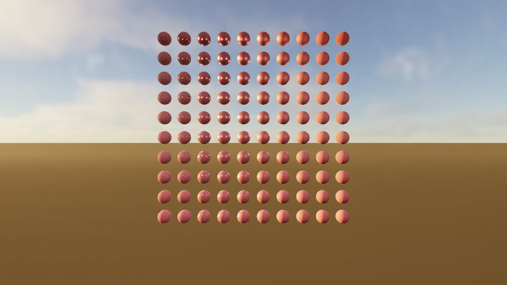

# Phosphor



Phosphor is a native Metal 4 renderer for Apple silicon, written in C++20 and
Metal Shading Language. It uses GPU-driven mesh submission and a visibility
buffer, with experimental ray-traced lighting, reflections, and volumetric
clouds. The test scenes are built to make rendering changes measurable.

[](docs/SHOWCASE.md)

[Watch and reproduce the demo](docs/SHOWCASE.md) · [Read the devlog](docs/devlog/2026-11-11-metal4.md) · [Contribute](CONTRIBUTING.md)

## Run on a Mac

Use an Apple silicon Mac with macOS 26 or later, Xcode 26 or later with the
Metal toolchain, CMake 3.25 or later, and Ninja. M3 or newer is the target for
the full feature path. Physical M3 and M4 test results are welcome.

```sh
brew install cmake ninja
xcrun -sdk macosx metal --version  # If missing, run xcodebuild -downloadComponent MetalToolchain
git clone https://github.com/yabanana/phosphor.git
cd phosphor
cmake -S . -B build -G Ninja -DCMAKE_BUILD_TYPE=Release
cmake --build build
./build/phosphor --bench 5
```

Bench 5 is a procedural scene with 1,024 lights. Use keys **1–8** to switch
scenes, **W/A/S/D** and right-drag in first-person scenes, or left-drag and
scroll in orbit scenes. The [scene guide](assets/README.md) covers the optional
Sponza download. The [renderer reference](docs/RENDERER.md) covers all benches,
controls, build modes, capture commands, and diagnostic flags.

On Linux, you can build the portable C++ core, run its tests, and type-check
the Metal host code using [the Linux build instructions](docs/RENDERER.md#building-on-linux-no-gpu).

## Renderer status

| Area | Current state |
| --- | --- |
| GPU-driven rendering | GPU scene and culling, mesh shaders and indirect draws, visibility buffer, HDR/EDR, and the F8 MetalFX temporal path |
| Ray tracing | BLAS/TLAS maintenance and diagnostic rays exercised on M5 Max |
| Lighting and atmosphere | Experimental shadows, ReSTIR DI, GI, reflections, denoising, atmosphere, fog, and clouds |
| Open validation | Physical M3/M4 measurements, dynamic reflection quality, native MetalFX wide-HDR admission, and the full-scene 1080p/60 fps budget |

The [F10–F14 integration report](docs/F10_F14_HANDOFF.md),
[budget follow-up](docs/implementation/F13-F14-BUDGET-CLOSURE-2026-10-08.md),
and [performance log](docs/perf-log.md) identify the workload and hardware
behind each result. The [roadmap](docs/ROADMAP.md) tracks future work. The
original Vulkan renderer is archived under [legacy/vulkan](legacy/vulkan/README.md).

## Contribute

A first contribution can be a **Many Lights benchmark on an M3 or M4**, a
**Linux build and test report**, or a **Metal capture for a single GPU pass**.
The [contribution guide](CONTRIBUTING.md) has the commands, what to attach, and
links to the open tasks.

## License and official upstream

[Apache License 2.0 with Commons Clause 1.0](LICENSE) applies to Phosphor's
first-party work. This is a source-available license. It allows study,
modification and redistribution under its terms, including use in a distinct
commercial product whose value does not derive substantially from Phosphor.
See [licensing and project identity](docs/LICENSING.md) for examples, third-party
scope, and how releases and contributions reach the official `main` branch.
