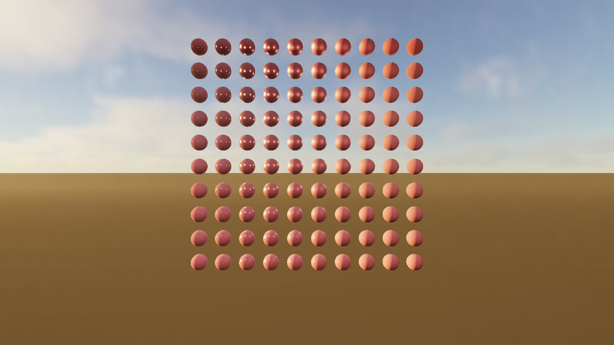

# Phosphor on Apple silicon

[](https://github.com/yabanana/phosphor/releases/download/metal4-preview-2026-11-11/phosphor-metal4-preview.mp4)

[Watch the MP4](https://github.com/yabanana/phosphor/releases/download/metal4-preview-2026-11-11/phosphor-metal4-preview.mp4) · [Preview release](https://github.com/yabanana/phosphor/releases/tag/metal4-preview-2026-11-11) · [Metal 4 devlog](devlog/2026-11-11-metal4.md)

The clip opens on a procedural PBR material grid. It then follows a camera
through the Culling Visualization scene as daylight changes, and ends with
Many Lights using ReSTIR DI and hardware ray tracing. Phosphor rendered all
three scenes on a physical M5 Max at 1280×720.
The clip plays back fixed-timestep frames. GPU timings below come from a
separate run without capture.

## Reproduce the captures

Build the [Release configuration](../README.md#run-on-a-mac), then run
these commands from the repository root. All three scenes are procedural and
require no asset downloads.

```sh
./build/phosphor --bench 2 --offscreen --resolution 1280x720 \
  --render-path visibility --atmosphere on --fog on --clouds on \
  --start-hour 15.5 --day-length 85 --frames 480 --warmup 0 --fixed-timestep \
  --no-ui --no-vsync --no-gpu-timing \
  --capture-sequence build/showcase/materials-clip --capture-every 2

./build/phosphor --bench 7 --culling-script --offscreen --resolution 1280x720 \
  --render-path visibility --atmosphere on --fog on --clouds on \
  --start-hour 7 --day-length 95 --frames 1200 --warmup 0 --fixed-timestep \
  --no-ui --no-vsync --no-gpu-timing \
  --capture-sequence build/showcase/city-flythrough --capture-every 2

./build/phosphor --bench 5 --offscreen --resolution 1280x720 \
  --render-path visibility --lighting restir --rt on \
  --frames 512 --warmup 0 --fixed-timestep --no-ui --no-vsync --no-gpu-timing \
  --capture-sequence build/showcase/lights-clip --capture-every 2
```

Each run writes PNG frames and per-frame metadata. The video uses every
second simulation frame at 30 frames per second. The city sequence is cut
to three camera segments.

## Many Lights benchmark

One capture-free run with 1,024 lights, 128 warmup frames and 256 measured
frames at 1280×720. M5 Max, macOS 27.3 (26C5035r), Xcode 27.2 (27B52),
Release, serial GPU timing, source commit `a83fcf7`.

| GPU time | p50 | p95 | p99 |
| --- | ---: | ---: | ---: |
| Many Lights | 8.49 ms | 8.55 ms | 8.68 ms |

[Download the benchmark JSON](https://github.com/yabanana/phosphor/releases/download/metal4-preview-2026-11-11/many-lights-m5-max.json).
For the exact command and what to include in a physical M3 or M4 result, see
[Contributing](../CONTRIBUTING.md#many-lights-on-a-physical-mac).
