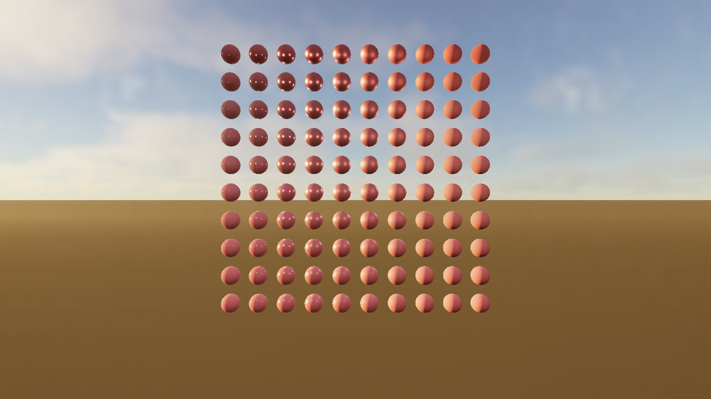

# What it takes to light a frame on Metal 4

*11 November 2026*

Phosphor started as a Vulkan renderer. The current renderer is a native
Metal 4 implementation in C++20 and Metal Shading Language. Apple silicon's
tile-based GPU and unified memory shape the frame. We keep raster intermediates
on the tile where possible, let the GPU build indirect draws, and track the
passes that move data through device memory.

## Two workloads, two questions

[The preview](../SHOWCASE.md) follows a scripted camera through a procedural
city while atmosphere, fog, and volumetric clouds change with the sun. The
Many Lights scene exercises a different part of the renderer. It has 1,024
procedural lights and uses ReSTIR DI to reuse light candidates across frames
and nearby pixels, with ray tracing for selected light visibility.

A capture-free Many Lights run on M5 Max at 1280×720 measured **8.49 ms median
GPU time and 8.55 ms at p95** over 256 frames after 128 warmup frames. The
[command and JSON](../SHOWCASE.md#many-lights-benchmark) make that workload
reproducible on another chip. The full 1080p Sponza lighting workload adds
GI, reflections, denoising, and volumes. Its 16.67 ms target remains open.

## Keeping the denoiser’s inputs in threadgroup memory

The custom lighting denoiser uses a 5×5 à trous stencil. At strides 1 and 2,
nearby threads read many of the same Float32 inputs. We stage those inputs
cooperatively in threadgroup memory before filtering. For a 16×8 output
group, the input footprints are 20×12 and 24×16. Threads synchronize before
the output bounds check so partial groups at the image edge still populate
their part of the tile.

We kept tap order, weights, and temporal rejection rules intact. A stride-4
tile exceeded the memory budget with shader validation enabled, so that
stride still uses the original kernel. The stencil comparison measured a
worst peak-normalized image error of 5.34×10⁻⁷ across the retained test runs.
The broader patch also changed short-ray aerial perspective sampling and
removed unused GI reservoir storage from the DDGI path. Three of six paired
timing comparisons met the drift criterion. Their full-frame GPU p50
reductions were 25.73–31.40%. See the [budget follow-up](../implementation/F13-F14-BUDGET-CLOSURE-2026-10-08.md)
for the controls, rejected runs, and remaining HDR and frame-budget work.

## Try it on another Mac

We're looking for physical **M3 and M4** results from the same 720p Many
Lights command, including build or runtime failures. If you work on Metal
or MSL, a capture of the local ReSTIR shading pass is useful too. The
[contribution guide](../../CONTRIBUTING.md) gives both entry points and says
what to attach.
